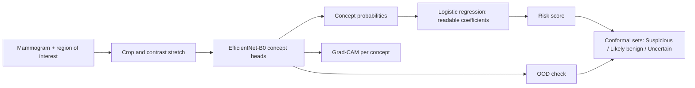

# Breast cancer screening: an interpretable mammography second reader

[](https://github.com/cyprio101/Breast_cancer_screening/actions)
[](https://colab.research.google.com/github/cyprio101/Breast_cancer_screening/blob/main/notebooks/01_train_mammo_cbm.ipynb)

**An interpretable second reader for mammography lesions.** A CNN recognises the concepts radiologists already use
(lesion type, mass shape, margins, calcification type and distribution, breast density). A small logistic regression on
those concepts makes the benign/malignant decision, so every step of the decision can be read, checked and corrected.

> **Research prototype. Not a medical device. Not validated for clinical use.**

<!-- Add a screenshot or GIF of the dashboard here: docs/dashboard.gif -->

## Why this design

Most medical image classifiers output one number that nobody can interrogate. Here the decision layer is transparent:

- **Exact explanations.** Each concept's contribution to the risk is additive in log-odds, relative to an average training lesion. This is not a post-hoc approximation.
- **Clinician in the loop.** If the model misreads a margin, the clinician changes it and the risk updates.
- **Calibrated uncertainty.** Class-conditional conformal prediction gives *Suspicious*, *Likely benign* or *Uncertain, refer*, with a stated per-class error level.
- **Out-of-distribution flag** for images unlike the training data.
- **Honest limits.** The CNN that perceives concepts is still a neural network, so concept accuracy is reported and Grad-CAM maps (approximate) are shown.



## Results

Filled in after training (see `docs/MODEL_CARD.md`). **No external validation has been done yet.**

| Metric (CBIS-DDSM official test set) | Value (95% CI) |
|---|---|
| AUC, concept-bottleneck model | TBD |
| AUC, same CNN with true concepts (ceiling) | TBD |
| AUC, black-box baseline | TBD |
| Brier score | TBD |
| Abstain rate at alpha = 0.10 | TBD |
| External test (INbreast or VinDr-Mammo) | TBD |

## Quick start

```bash
git clone https://github.com/cyprio101/Breast_cancer_screening.git && cd Breast_cancer_screening
pip install -e ".[app,dev]"
pytest -q                                   # logic tests on synthetic data
```

1. **Train** in Colab (GPU): open `notebooks/01_train_mammo_cbm.ipynb`, set the repo URL and the CBIS-DDSM folder, run all cells. It writes `mammo_cbm_bundle.pt`.
2. **Run the dashboard:** place the bundle at `models/mammo_cbm_bundle.pt`, then `streamlit run app/app.py`.

Weights are not committed. Publish them via GitHub Releases or the Hugging Face Hub and link them here.

## Repository layout

```
src/mammo_cbm/   package: imaging, model, conformal, inference
app/app.py       Streamlit dashboard
notebooks/       training and evaluation (Colab)
tests/           pytest, synthetic data
docs/            model card
```

## Limitations

- Trained on one public dataset of digitised film mammograms; region-based, not whole-image screening.
- No prospective, external, multi-scanner or subgroup validation yet.
- Concept labels come from the dataset's annotations, which carry reader variability.
- Grad-CAM shows where the network looked, not why it is correct.

## Data and citation

CBIS-DDSM (Lee et al., 2017) via The Cancer Imaging Archive; follow the TCIA data-use terms. If you use or adapt this work, please credit the author (Kalule Cyprian Ateesa Kawooya) and cite it using `CITATION.cff`. The licence requires the copyright notice to be kept in copies.
Methods: concept bottleneck models (Koh et al., 2020), Grad-CAM (Selvaraju et al., 2017), EfficientNet (Tan & Le, 2019),
conformal prediction (Vovk et al.; Angelopoulos & Bates, 2021).

## Licence

MIT. See `LICENSE`.
